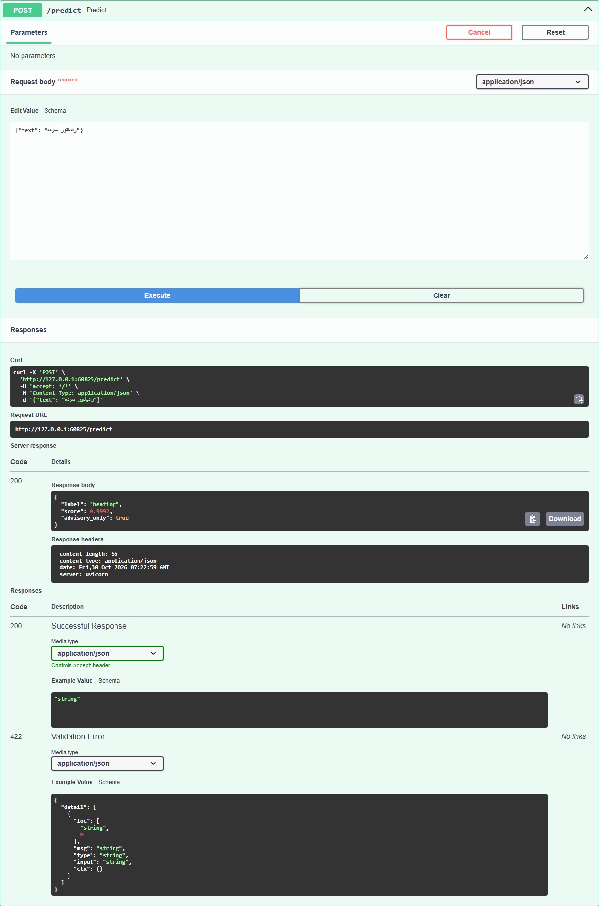
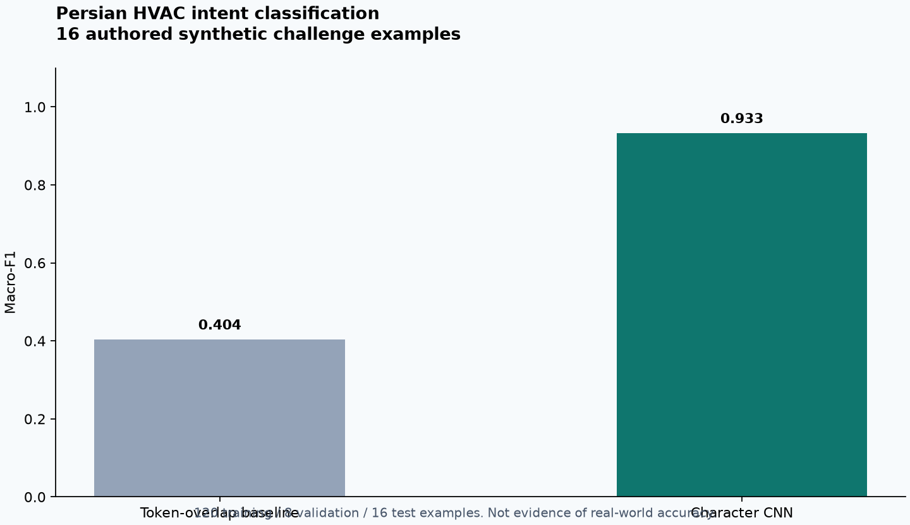

# Persian HVAC Tiny Triage

A 5,744-parameter character CNN trained from scratch to route Persian heating-service messages into eight reported-symptom or service-request categories.

[راهنمای فارسی](README.fa.md) · [Recorded results](docs/synthetic-results.json) · [Environment](docs/experiment-environment.json)

**Status:** reproducible experiment on a very small authored synthetic dataset. It classifies what a customer reports; it does not diagnose a defective part, determine emergency priority or provide repair instructions.

## Actual model inference



This is an actual local API execution using trained weights. Input text is synthetic. [Capture provenance](docs/images/provenance.json) records the source.

## Recorded experiment — synthetic data only



| Item | Recorded value |
|---|---:|
| Training examples | 120 |
| Validation examples | 8 |
| Challenge examples | 16 |
| Parameters | 5,744 |
| Saved weights | 25,475 bytes |
| CNN Macro-F1 | 0.933 |
| Token-overlap baseline Macro-F1 | 0.404 |
| Abstention threshold | 0.4 |
| Mean local CPU inference | 0.357 ms |

The baseline is token overlap, not TF-IDF or a pretrained model. The tiny challenge set and single seed make these numbers exploratory. They do not establish customer-message accuracy, out-of-domain performance or speed on other machines. Latency is a historical measurement over 100 local calls, excluding network, startup and concurrency. A small weight file does not make the PyTorch runtime small.

The [full report](docs/synthetic-results.json) includes a misclassification: an error-display message was classified as an installation request. This negative result is retained.

## Categories

| Label | Reported request |
|---|---|
| `hot_water` | Domestic hot-water problem |
| `heating` | Cold radiator / heating problem |
| `leak` | Reported water leakage |
| `error_code` | Displayed error code |
| `noise` | Unusual sound |
| `maintenance` | Maintenance request |
| `installation` | Installation request |
| `price` | Price inquiry |
| `review` | Confidence below the selected threshold |

Labels describe messages, not technical causes. `score` is an uncalibrated softmax value; confident mistakes are possible, including for unrelated input.

## Architecture and data split

```text
Persian text -> normalization -> 160 character IDs
             -> embedding (24 dimensions)
             -> Conv1d (48 channels, kernel 3)
             -> ReLU -> global max pooling -> 8 logits
```

All phrases are authored in [data.py](data.py). Base phrase families are split before greeting/prefix augmentation: five families per class for training, one for validation and two for challenge testing. The threshold uses validation only. Challenge examples do not enter the optimization loop. Seed 42 is fixed.

This keeps exact template families disjoint; it does not remove all lexical bias or establish generalization beyond these authored phrases.

## Reproduce

Python 3.11+ and a platform-supported PyTorch build:

```sh
python -m venv .venv
# Linux/macOS: source .venv/bin/activate
# PowerShell: .venv\Scripts\Activate.ps1
python -m pip install -r requirements.txt
python train.py
python -m unittest -v
python -m uvicorn serve:create_app --factory --host 127.0.0.1 --port 8001 --no-access-log
```

Training creates `artifacts/model.pt`, `metadata.json` and `report.json`. These runtime artifacts are ignored by Git and regenerated with `train.py`. The committed report records the original experiment; timings can differ when reproduced. Training/inference run on CPU and require no external model API key. Tested direct dependency versions are in `requirements-tested.txt`.

## API

Open `http://127.0.0.1:8001/docs` or send:

```sh
curl -X POST http://127.0.0.1:8001/predict \
  -H 'Content-Type: application/json' \
  -d '{"text":"رادیاتور سرده"}'
```

The response contains `label`, `score` and `advisory_only: true`. Inputs are limited to 2,000 characters; encoding uses the first 160 normalized characters. `GET /health` reports process health. `MODEL_DIR` can select an artifact directory with the same architecture.

This API has no Internet-facing authentication/abuse controls. Bind it to loopback or private networking. Load only your own trusted artifacts; loading uses `weights_only=True`.

## Assistant integration

The standalone [heating support assistant](https://github.com/MehradYaghoubi/heater-support-assistant) can call this service through `TRIAGE_URL=http://127.0.0.1:8001`. Model failure does not stop its source-based response path. Danger handling is independent of this classifier.

The Dockerfile trains the synthetic model during build and serves a private API. Docker deployment has not been verified on the user's host. A shared cPanel account may lack the memory/disk budget for PyTorch; this component is optional for website deployment.

## Checks and next experiments

Tests verify disjoint phrase families, Persian normalization and model output dimensions. Stronger follow-up experiments need more independently authored phrases, TF-IDF linear baselines, unrelated input, repeated seeds, confidence calibration and measured quantization. These are future work, not completed capabilities.

## Files

- `data.py`: synthetic phrases and split construction.
- `model.py`: normalization, encoder, CNN and predictor.
- `train.py`: optimization, threshold selection, baseline and metrics.
- `serve.py`: private inference API.
- `test_model.py`: behavioral checks.
- `docs/`: recorded results, environment, actual API screenshot and comparison figure.
